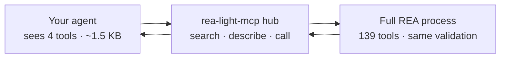

# rea-light-mcp

> Reverse-engineer shipped software with your AI agent — through 4 tiny tools strict models accept, with all 139 REA capabilities behind them.

[](https://www.npmjs.com/package/rea-light-mcp)
[](https://opensource.org/licenses/MIT)
[](https://nodejs.org/)
[](https://modelcontextprotocol.io/)
[](https://github.com/M0-AR/rea-light-mcp)


**Abstract.** Full reverse-engineering servers expose ~139 tools with deeply nested settings (~1.9&nbsp;MB of schemas, nesting up to depth 14). Strict AI providers (Muse Spark / Gemini / Moonshot enforce a 10-level schema cap; Moonshot additionally caps ~14&nbsp;KB per schema) reject the **entire request** when a single tool breaks the limits — even a plain `hi`. `rea-light-mcp` is a facade: it shows the model **4 flat tools (~1.5&nbsp;KB total, depth ≤ 2, zero references)** and keeps the complete REA catalog server-side behind one persistent REA process. Same server, same validation, same results — no more refusals. If you can ask a question in plain English, you can reverse-engineer with this.

🌐 **Live interactive page + quiz:** [rea-light-mcp home](https://m0-ar.github.io/rea-light-mcp/) · [preview.html](https://m0-ar.github.io/rea-light-mcp/preview.html) · [docs/preview.html](https://m0-ar.github.io/rea-light-mcp/docs/preview.html) · 📦 [npm](https://www.npmjs.com/package/rea-light-mcp) · 💻 [GitHub](https://github.com/M0-AR/rea-light-mcp)

## Contents

- [Quick start](#quick-start)
- [🌱 Beginner guide — read this and you are a professional](#-beginner-guide--read-this-and-you-are-a-professional)
- [Demo](#demo)
- [Features](#features)
- [The 4 tools](#the-4-tools)
- [How it works](#how-it-works)
- [Full REA vs rea-light-mcp](#full-rea-vs-rea-light-mcp)
- [Configure (OpenCode, Claude, Cursor)](#configure-opencode-claude-cursor)
- [Environment variables](#environment-variables)
- [Recipes](#recipes)
- [Who uses it, for what](#who-uses-it-for-what)
- [Troubleshooting](#troubleshooting)
- [Development](#development)
- [FAQ](#faq)
- [License](#license)

## Quick start

Run it right now — no install:

```bash
npx -y rea-light-mcp
```

Point your agent at it (OpenCode `~/.config/opencode/opencode.jsonc`):

```jsonc
"rea-light": {
  "type": "local",
  "command": ["npx", "-y", "rea-light-mcp"],
  "enabled": true,
  "timeout": 120000
}
```

Then ask your agent:

> Using rea_investigate, open /usr/bin/ls and tell me what kind of binary it is.

Disable the full `rea` server in the same file (`"enabled": false`) — that is the catalog strict models reject. Restart the agent session after editing.

## 🌱 Beginner guide — read this and you are a professional

**1. What is MCP?** A standard plug for AI assistants. A "server" is a small program that gives your assistant new skills, called tools. You configure it once; every chat after that can use it.

**2. What is reverse engineering?** Learning how a finished program works *without* its source code: what each part does, where data flows, how files are built. Only ever use it on software you own or are allowed to examine.

**3. Why does the "light" version exist?** The full REA toolset is so large (~139 tools) that strict AI models refuse to talk while it is connected — one oversized tool blocks everything. This package shows the model 4 simple tools and keeps the other 139 behind a curtain. Same power, no refusal.

**4. The everyday loop has 3 steps.** `rea_search` finds what REA can do ("decompile", "apk", "firmware") → `rea_describe` shows one tool's settings as plain text → `rea_call` runs it. Or skip all three: `rea_investigate` takes a file plus one question and returns the answer with evidence ids.

**5. What you get back.** Short markdown answers with evidence ids you can follow up on — never a wall of raw data. Deep disassembly needs professional engines (Ghidra, Hopper, IDA) installed separately; opening, fingerprinting and metadata work with nothing extra.

Finish the [8-question quiz](https://m0-ar.github.io/rea-light-mcp/preview.html#quiz) on the live page and you will know more than most interview candidates.

## Demo

Real session, recorded against the published package:


Interactive version with screenshots: [home](https://m0-ar.github.io/rea-light-mcp/) · [preview.html](https://m0-ar.github.io/rea-light-mcp/preview.html) · [docs/preview.html](https://m0-ar.github.io/rea-light-mcp/docs/preview.html) ([screenshot](https://raw.githubusercontent.com/M0-AR/rea-light-mcp/main/docs/images/preview.png)). Package page: [npm](https://www.npmjs.com/package/rea-light-mcp) ([screenshot](https://raw.githubusercontent.com/M0-AR/rea-light-mcp/main/docs/images/npm-page.png)).

## Features

- **Passes strict models.** 4 advertised tools, ~1.5&nbsp;KB schemas, depth ≤ 2, zero `$ref` — 9× under per-schema size caps, 5× under depth caps.
- **Loses nothing.** All 139 REA capabilities stay callable with identical arguments, validation and output.
- **The string trick.** Complex settings travel as one flat text field (`args_json`); real checking happens inside, unchanged.
- **Session-preserving.** One persistent REA process behind the hub: open → inspect → evidence → close works across calls.
- **Read-only by default.** Rename/comment tools stay blocked until you opt in with `REA_LIGHT_ALLOW_WRITE=1`.
- **Markdown answers.** Truncated, evidence-linked output instead of megabyte dumps.
- **Zero new engines.** No Ghidra/Hopper/IDA installs, no providers to configure — the hub adds no dependencies beyond REA itself.
- **Two runtime deps only** (`@modelcontextprotocol/sdk`, `zod`), Node ≥ 18.

## The 4 tools

| Tool | Input (all flat) | What |
|------|------------------|------|
| `rea_search` | `query:string, domain?:enum, limit?:1-10` | Keyword search over the cached REA catalog, top briefs (name + one line). No heavy schemas. |
| `rea_describe` | `name:string` | One tool's full settings as **markdown text** (never as a schema, so limits never trigger). |
| `rea_call` | `name:string, args_json:string` | Run any REA tool; complex arguments travel as a **string**, validated server-side. |
| `rea_investigate` | `target:string, question:string, depth?:enum` | Pinned one-shot entry: open + inspect, final markdown only. |

Domains for `rea_search`: `native`, `managed`, `js`, `web`, `mobile`, `runtime`. Depth for `rea_investigate`: `quick`, `standard`, `deep`.

## How it works



1. On first use the hub starts one REA server process and caches its tool list (keyword index, rebuilt if the catalog changes).
2. `rea_search` matches names/descriptions (top 5 by default) and returns briefs — full schemas never enter the model's context.
3. `rea_describe` renders one tool's schema as text output (providers check *input* schemas strictly, text leniently).
4. `rea_call(name, args_json)` parses the JSON string, validates the shape, forwards to REA, truncates the result to markdown (~6,000 chars) with evidence ids for follow-ups.
5. `rea_investigate` runs open → inspect internally and returns only the final answer — intermediate evidence never crosses the model boundary.

## Full REA vs rea-light-mcp

| | Full REA | rea-light-mcp |
|---|---|---|
| Advertised tools | 139 | **4** |
| Catalog size | ~1.9 MB | **~1.5 KB** |
| Max schema depth | 14 (+ recursive refs) | **≤ 2, zero refs** |
| Strict models (Spark/Gemini/Moonshot) | rejected on every message | **accepted** |
| Capabilities reachable | 139 | **139 (same)** |
| Validation / results | canonical | **identical (same server)** |
| Calls per task | 1 | 1–3 (1 via `rea_investigate`) |
| Write actions | allowed by engine | **blocked by default, opt-in** |

## Configure (OpenCode, Claude, Cursor)

OpenCode `~/.config/opencode/opencode.jsonc`:

```jsonc
"rea":       { "type": "local", "command": ["npx", "-y", "rea-agents@6.4.0", "mcp"], "enabled": false },
"rea-light": { "type": "local", "command": ["npx", "-y", "rea-light-mcp"], "enabled": true, "timeout": 120000 }
```

Claude Code / Cursor / Windsurf (`mcp.json`-style):

```json
{
  "mcpServers": {
    "rea-light": { "command": "npx", "args": ["-y", "rea-light-mcp"] }
  }
}
```

Restart the agent session after editing. First run downloads packages — give it a minute.

## Environment variables

| Variable | Default | Notes |
|----------|---------|-------|
| `REA_COMMAND` | `npx -y rea-agents@6.3.0 mcp` | Which REA server runs behind the hub (pinned measured 139-tool release). |
| `REA_TIMEOUT_MS` | `120000` | Per-call timeout; stdio serves calls one at a time. |
| `REA_LIGHT_ALLOW_WRITE` | unset (read-only) | Set to `1` to allow `annotate_*` / `set_*` write-path tools. |

## Recipes

**Fingerprint a binary:**

> Using rea_investigate, open /usr/bin/ls and tell me format, architecture and sha.

**Find how to decompile:**

> Using rea_search, find decompile capabilities. Then rea_describe analyze_function. Then rea_call it on my opened target.

**Check what's available on this machine:**

> Using rea_call with name binary_session and args_json {}, show me which operations are available and why some are not.

**Compare two builds** (needs two evidence ids from earlier calls):

> Using rea_call compare_functions with both evidence ids, what changed?

## Who uses it, for what

- **App developers** — "How does this feature work in the app I admire?" Trace it, see the evidence, rebuild it cleanly in your own project.
- **Security learners** — Inspect binaries you own; practice reading assembly and metadata with an AI tutor that shows its sources.
- **Students** — From "what is a binary?" to reading call graphs; the [quiz](https://m0-ar.github.io/rea-light-mcp/preview.html#quiz) takes you from zero to pro.
- **Strict-model users** — Anyone whose model rejects huge tool catalogs; 4 flat tools pass every known depth/size gate.
- **Agent builders** — A stable 4-tool surface that never grows: REA can add 30 tools and your prompts don't change.

For lawful research, education and interoperability on software you own or are authorized to examine.

## Troubleshooting

**`hi` fails with "JSON schema exceeds the maximum nesting depth of 10 levels"** — the full `rea` server is still enabled. Set `"enabled": false` on `rea`, keep `rea-light` enabled, restart the session.

**First call is slow / times out** — `npx` downloads `rea-light-mcp` + `rea-agents` on first run. Re-run; later calls reuse the cache. The `120000` timeout in config covers this.

**`provider_unavailable` / needs Ghidra, Hopper, IDA** — deep disassembly needs professional engines you install yourself; this package never installs them. Opening, fingerprinting and metadata need nothing extra.

**`needs REA_PWNTOOLS_PYTHON ... pwntools`** — layout inspection needs a caller-supplied Python with pwntools 4.15.0 + pyelftools + Unicorn. Same rule: bring your own engine.

**Write tool blocked** — set `REA_LIGHT_ALLOW_WRITE=1` in the server environment to allow rename/comment tools.

## Development

```bash
git clone https://github.com/M0-AR/rea-light-mcp.git
cd rea-light-mcp
npm install
npm run build        # tsc -> dist/
npm run typecheck    # strict, must pass
npm run check:schemas # catalog guard: 4 tools, depth ≤ 2, < 10 KB total
```

Verified end-to-end before release: build + typecheck + schema guard + stdio `initialize`/`tools/list` + live `rea_search`/`rea_describe`/`rea_call` against real REA + ELF open/evidence/close lifecycle + fault injection (bad JSON, unknown tool, write-block) — 17/17 checks green.

## FAQ

**Is this a replacement for REA?** No — it *is* REA through a smaller door. Same server, same checks, same results. On models without strict limits, full REA works too.

**Why not just 5 flat domain tools?** Flat tools re-introduce deep schemas or drop capabilities. The hub keeps all 139+ with constant catalog bytes — the dispatcher + progressive-discovery consensus.

**Does it upload my files?** No. Everything runs on your machine; the model provider only sees the text you discuss.

**Can the catalog grow?** REA can add tools freely — the hub's 4-tool surface never changes. Re-run `rea_search` to discover newcomers.

## License

MIT — see [LICENSE](LICENSE). Built on [REA](https://github.com/morluto/rea) (MIT), which retains its own notices; professional engines (Ghidra, Hopper, IDA) need their own licenses.
